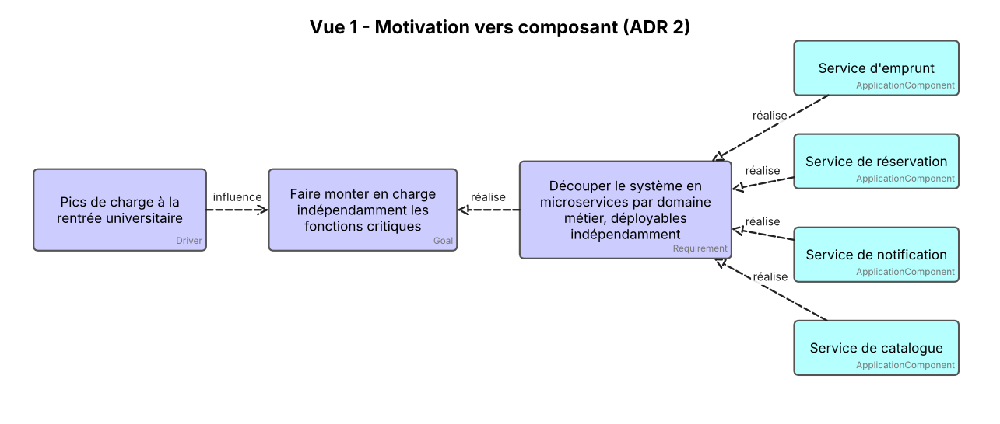
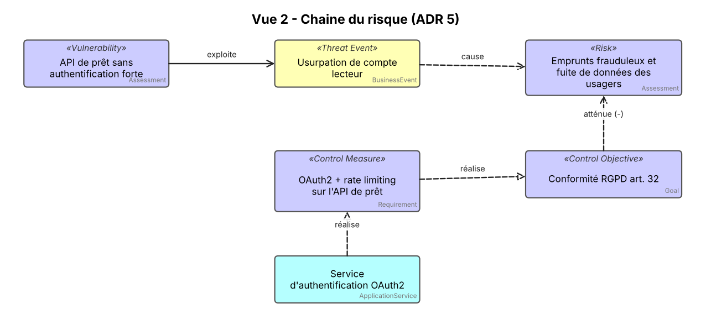

Dépôt : `TP-ADR-Bellagnech-Achemlal`. Cas d'étude : système de gestion de bibliothèque
(emprunts, réservations, notifications). Les ADR sont dans `doc/adr/`, les vues ArchiMate
dans `doc/archimate/`.

# Partie 1 — Étude théorique

## 1. Qu'est-ce qu'un ADR ? Avantages par rapport à une documentation classique

Un **ADR** (*Architecture Decision Record*) est un court document qui consigne **une**
décision d'architecture : son contexte, la solution retenue, les alternatives écartées et
les conséquences. Il suit un gabarit fixe (titre, statut, contexte, décision, alternatives,
conséquences) et reste bref.

Par rapport à une documentation classique (document d'architecture global, wiki) :

- il garde le **pourquoi** et pas seulement le *quoi* : un schéma montre l'état actuel,
  l'ADR explique le raisonnement qui y a mené ;
- il est **versionné avec le code** dans le même dépôt Git, relu en Pull Request, donc il
  évolue au même rythme que le système et se désynchronise moins vite qu'un wiki ;
- il est **granulaire** : une décision = un fichier, facile à retrouver, à lier et à
  remplacer ;
- il est **immuable une fois accepté** : on ne le réécrit pas, on en écrit un nouveau qui
  le remplace, ce qui conserve l'historique du raisonnement ;
- il est peu coûteux à écrire, ce qui le rend réaliste dans un projet agile.

## 2. Trois outils ou méthodes pour gérer les ADR

| | **adr-tools** | **MADR** | **Log4brains** |
|---|---|---|---|
| Nature | Outil en ligne de commande (scripts shell) | Modèle (*template*) Markdown normalisé | Outil qui génère un site de consultation |
| Ce qu'il fait | Crée, numérote et relie les ADR (`adr new`, `adr init`) | Propose la structure d'un ADR (options, avantages et inconvénients) | Construit un « journal des décisions » navigable à partir des fichiers Markdown |
| Points forts | Léger, scriptable, aucun serveur | Portable (du Markdown pur), très lisible | Recherche, filtres par statut, publication en site statique |
| Limites | Pas d'interface de consultation | N'automatise rien seul | Demande Node.js, un peu plus lourd |
| Usage | Gestion au quotidien | Format des fichiers | Diffusion à toute l'équipe |

Ces outils se **combinent** : on peut écrire des fichiers au format MADR, les créer avec
adr-tools et les publier avec Log4brains. Dans ce TD, nous avons choisi une approche
minimale (gabarit du sujet, script de validation `check_adr.sh`, script d'index
`gen_adr_index.py`), compatible avec les trois.

## 3. Pourquoi documenter les alternatives et les conséquences ?

Sans cela, un ADR n'enregistre que le résultat et on perd le raisonnement.

- **Alternatives** : elles évitent de ré-explorer plus tard une piste déjà écartée pour les
  mêmes raisons, et elles répondent à la question « pourquoi pas X ? ». Quand le contexte
  change (la contrainte qui justifiait le rejet disparaît), on sait quelle alternative
  réexaminer. Exemple : dans notre ADR 5, la clé API statique est rejetée car on ne peut
  pas la révoquer par client ; si un fournisseur offrait cette révocation, la question
  pourrait être rouverte.
- **Conséquences** : elles rendent les compromis **explicites**, y compris les conséquences
  négatives (complexité, latence, nouvelle dépendance). On sait ce qu'on a accepté de payer
  et ce qu'il faudra surveiller. Elles aident aussi à trouver les liens entre décisions :
  les inconvénients de l'ADR 1 (une base principale difficile à faire monter en charge)
  motivent les ADR 2 et 3.

## 4. Risques d'une mauvaise gestion des décisions d'architecture

- **Perte de la mémoire d'architecture** : le raisonnement n'est que dans la tête de
  quelques personnes et disparaît avec leur départ (rotation, fin de contrat).
- **Décisions refaites sans le savoir**, ou remises en cause sans connaître leurs raisons :
  le même débat recommence.
- **Dérive architecturale** : le code s'écarte des décisions prises, ou des équipes
  appliquent des règles différentes.
- **Dette technique** et régressions, parce qu'on modifie un composant sans comprendre
  la contrainte qui justifiait son état actuel.
- **Impossibilité de justifier un choix lors d'un audit** (sécurité, RGPD) : « pourquoi ce
  composant n'est-il pas chiffré ? » doit avoir une réponse tracée, pas reconstruite après
  coup.
- **Décisions de sécurité oubliées** : ce sont les moins documentées et les plus coûteuses à
  retrouver après un incident.

# Partie 2 — Les cinq ADR (résumé)

Les ADR complets sont dans `doc/adr/` (un commit par ADR). Ils suivent le gabarit du
sujet et sont reliés entre eux par des liens Markdown.

| # | Décision retenue | Alternative principale rejetée |
|---|---|---|
| 1 | PostgreSQL avec réplication en streaming | MongoDB (cohérence transactionnelle) |
| 2 | Découper le système en microservices par domaine métier, déployables indépendamment | Monolithe modulaire |
| 3 | Verrouillage optimiste des réservations (colonne version et nouvelle tentative) | Verrouillage pessimiste |
| 4 | File de messages asynchrone (RabbitMQ) consommée par un Service de notification dédié | Appels synchrones directs |
| 5 | **OAuth2 + rate limiting sur l'API de prêt** (**décision de sécurité**) | Clé API statique partagée |

Liens entre ADR : l'ADR 1 (limites de la base) motive l'ADR 2 ; l'ADR 3 s'appuie sur
PostgreSQL (ADR 1) dans le Service de réservation (ADR 2) ; l'ADR 4 prolonge le découpage
de l'ADR 2 ; l'ADR 5 protège le point d'entrée de l'architecture de l'ADR 2.

L'ADR 5 répond explicitement à des catégories **STRIDE** : *Spoofing* (usurpation d'un
compte lecteur), *Information disclosure* (énumération de comptes) et *Denial of service*
(robots de réservation en masse).

# Partie 3 — Vues ArchiMate

Les deux vues sont dans le modèle `doc/archimate/bibliotheque.archimate` (à ouvrir avec Archi
≥ 4.9) et exportées en image. Leurs éléments reprennent **mot pour mot** le vocabulaire des
ADR ; le script `scripts/make_views.py` vérifie cette correspondance.

## Vue 1 — Chaîne motivation → composant (ADR 2, décision non liée à la sécurité)

Le *Requirement* est la phrase de l'ADR 2 : « Découper le système en microservices par
domaine métier, déployables indépendamment ». Il est réalisé par les quatre composants
issus de la décision (Service d'emprunt, de réservation, de notification et de catalogue).

## Vue 2 — Chaîne du risque (ADR 5, décision de sécurité)

Cette vue suit le *Risk and Security Overlay* (white paper W150 de l'Open Group) : la
*Vulnerability* est exploitée par un *Threat Event* qui cause le *Risk* ; le *Control
Measure* (la décision de l'ADR 5 : « OAuth2 + rate limiting sur l'API de prêt », réalisée
par le Service d'authentification OAuth2) réalise le *Control Objective* « Conformité RGPD
art. 32 », qui atténue le *Risk*.

Dans Archi, *Vulnerability* et *Risk* sont des spécialisations d'**Assessment**, *Threat
Event* une spécialisation de **Business Event** (Specializations Manager). Nous avons aussi
nommé *Control Measure* (sur Requirement) et *Control Objective* (sur Goal) pour que
chaque boîte porte son rôle dans la chaîne.

# Partie 4 — Workflow Git

- Un dépôt Git avec le dossier `doc/adr` et un `doc/adr/README.md` expliquant comment
  contribuer (gabarit, numérotation, statuts, processus de revue).
- **Validation du gabarit** : le script `scripts/check_adr.sh` vérifie le titre
  `# N. Titre`, les cinq sections et la valeur du statut. Il est appelé par le **hook
  `pre-commit`** (`hooks/pre-commit`, activé avec `scripts/install_hooks.sh`) et par la
  **CI** (`.github/workflows/adr-lint.yml`).
- **Commits atomiques** : un commit par ADR, puis un commit par ensemble cohérent (vues,
  bonus, rapport).
- **Tag** : `v1.0-adr-final`, posé quand les cinq ADR sont acceptés.
- **Bonus** : `scripts/gen_adr_index.py` génère `doc/adr/INDEX.md`.

# Partie 5 — Analyse et discussion

## 1. Avantages et limites des ADR pour notre projet

**Avantages.** Les ADR sont légers et versionnés avec le code. Ils expliquent le *pourquoi*
des cinq choix structurants, et le lien avec ArchiMate rend chaque décision traçable
jusqu'à un objectif (vue 1) ou un risque (vue 2). Le hook et la CI garantissent que tous
les ADR gardent la même structure.

**Limites.** Un ADR ne remplace pas une documentation d'ensemble (type arc42 ou vues C4) : il
donne les décisions, pas la vue globale du système. Il peut devenir obsolète si personne
ne le relit après une évolution du contexte, et le script ne contrôle que la **forme** :
il ne détecte pas une décision mal justifiée. Enfin, la qualité dépend de la discipline de
l'équipe (rédiger l'ADR au moment de la décision, pas après).

## 2. Automatiser la gestion des ADR

- La **validation de structure** (hook + CI) est un premier niveau, déjà en place.
- Un **bot GitHub** peut commenter toute Pull Request qui touche `doc/adr/` avec un résumé
  de l'ADR (titre, statut, décision) et demander une revue, ou échouer si un ADR passe à
  `Accepte` sans relecture.
- Une étape de CI peut **régénérer l'index** (`gen_adr_index.py`) à chaque fusion, ou publier
  un site navigable avec Log4brains ou MkDocs à partir des mêmes fichiers.
- Un **contrôle de cohérence** (comme celui de `make_views.py`) peut échouer le build si un
  nom de la vue ArchiMate ne correspond plus à l'ADR.
- Une CI peut aussi vérifier que les liens entre ADR pointent vers des fichiers existants.

## 3. Amélioration proposée du processus de rédaction

**Lier chaque ADR à un ticket** (issue GitHub ou GitLab) qui porte le besoin d'origine, avec
une **revue obligatoire par un pair** avant le passage à `Accepte`. On gagne ainsi la
traçabilité décision ↔ besoin (et plus seulement décision ↔ code), et on évite qu'une
décision soit prise et documentée par une seule personne. Pour les décisions de sécurité,
on ajouterait dans le gabarit une ligne « Menace traitée (STRIDE) » afin qu'aucune
décision de sécurité ne reste sans risque identifié en face.
